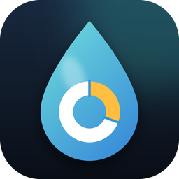

<p align="center"></p>
<h1 align="center">流水分析助手 · Ledger Lens</h1>
<p align="center">把各家银行、微信、支付宝的账单和工资凭证丢进来，看清每个月钱去了哪。<br>Windows 桌面程序 + 安卓 App，数据只留在你自己的设备上。</p>

## 下载

到 [Releases](../../releases/latest) 下载：

| 文件 | 说明 |
|---|---|
| `LedgerLens-windows.exe` | Windows 10 / 11，单文件，双击即用，无需安装 Python |
| `LedgerLens-android.apk` | 安卓 7.0 及以上（需允许“安装未知来源应用”）。调试签名，尚未在真机上测试 |

## 功能

- **多格式导入**：PDF 对账单（含扫描件）、手机截图 / 照片（离线 OCR）、Excel、CSV、Word、网页表格、OFX。一次可选多家银行的文件，或直接拖进窗口。导入前逐行核对、可修改，自动识别重复记录。
- **收入凭证**：工资条、到账截图、收入证明 PDF 都能导入，自动找“实发 / Net Pay / 到账金额”。
- **自动分类**：中英文商户关键词；你改过一次分类，同类交易以后自动归类。信用卡还款、自己账户互转不计入收支。
- **分析**：收支与结余、储蓄率、分类占比、近 12 个月趋势、环比与近 3 月均值对比、每日 / 星期分布、商户排行、账户分布。
- **分类明细**：点任意分类、商户或账户，列出每一笔的日期、商家、**哪家银行哪张卡**付的。
- **开销建议**：财务健康评分、逐条建议（结论 + 依据 + 做法 + 现状对目标的进度条）、下月建议预算、固定扣费清单。
- **手机同步**：电脑端开启后，手机扫码即可查看全部分析；安卓 App 会保存数据离线可看，手机上记的账回到同一 Wi-Fi 自动传回电脑。
- **只算真实收支**：信用卡还款、自己账户间互转、转入证券账户自动标为“不计收支”；买了又退的商品两笔都不算，部分退款和返现冲减支出；工资单独统计。
- **多种货币**：逐笔识别币种（人民币、美元、港币、欧元、英镑、日元、韩元等 30 种），默认按币种分开展示；也可以一键合并，按当前参考汇率折算成你选的货币出总报告。
- **内部转账确认**：把握高的自动处理（还款字样、账单户名、自己另一张卡的尾号、两头账单对得上）；拿不准的转账路线列出来由你确认一次，以后自动识别。
- **五种语言**：中文、English、Français、Español、한국어，随时切换。
- 深色模式、多币种（分币种统计）、导出 Excel 报告。

开发记录见 [DEVLOG.md](DEVLOG.md)（[English](DEVLOG.en.md)），接手开发先读 [AGENTS.md](AGENTS.md)。

## 手机同步怎么用

1. 电脑端打开「手机同步」→ 开启。首次开启时 Windows 防火墙若弹窗，请允许“专用网络”。
2. 手机和电脑连同一个 Wi-Fi，用相机扫页面上的二维码——浏览器里就能直接用（任何手机都行）。
3. 安卓用户可以安装 APK：扫码后在「同步」页点“在 App 中打开”，或在 App 里手动填电脑地址和 8 位配对码。

同步只走你家里的局域网，不经过任何服务器；接口需要配对码，连续输错会被暂时锁定。同步服务默认关闭。

## 隐私

- 所有数据保存在本机：`%APPDATA%\LedgerAssistant\data.db`，程序不联网上传任何内容。
- 唯一的联网请求：使用“合并”货币视图时从 open.er-api.com 下载公开汇率表（不带任何参数，不发送你的数据）；没网时用内置的参考汇率。
- 文字识别使用随程序打包的离线模型。
- `samples/` 里的账单全部是脚本生成的虚构数据。

## 从源码运行 / 打包

```bat
python -m venv .venv
.venv\Scripts\pip install -r requirements.txt
.venv\Scripts\python app\main.py
build.bat
```

安卓 App 在 `android/`，界面与电脑端共用 `app/web/mobile`；推送 `v*` 标签后由 GitHub Actions 自动构建 APK 并附到 Release。

## 目录

| 路径 | 内容 |
|---|---|
| `app/parsers.py` | 文件解析（表格 / 文本行 / OCR 三条通路） |
| `app/categorize.py` | 分类规则 |
| `app/analysis.py` | 月度分析与建议引擎 |
| `app/sync_server.py` | 局域网同步服务 |
| `app/web/` | 电脑端界面；`app/web/mobile/` 手机端界面 |
| `android/` | 安卓 App 工程 |
| `samples/` | 虚构测试账单与自测脚本 |

## 说明

建议由规则生成，仅供参考，不构成理财或投资建议。真实账单版式很多，导入时请核对识别结果；遇到识别不了的版式欢迎提 Issue（请先抹掉个人信息）。

License: MIT
